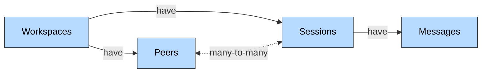

# The Structure of Honcho

Honcho is a Memory service for agents. It examines the conversations
continuously and builds a profile of each peer. The profile gets more facts with
time.

The agents write messages through an HTTP API. Workers examine these messages
after the API stores them, and the API does not wait for the workers. A query
endpoint accepts a query in usual English and gives a reply about a peer. Each
part of this reply comes from the stored conclusions.

## Data model

The data model has these items. A workspace holds peers and Honcho sessions. A
Honcho session holds messages.

- **Workspaces** are the containers at the top. Each workspace isolates its data
  fully from the other programs or environments. One workspace holds the data of
  one group of tasks. Thus a service for many customers can keep the data of
  each customer isolated.
- **Peers** are the primary items of the system. A peer is a user, an agent or a
  different item that stays for a long time. All of the system builds and keeps
  the profiles of peers. A peer can be in two or more Honcho sessions. It
  collects context across these Honcho sessions.
- **Honcho sessions** are threads of conversation between peers, or limits in
  time. In a Honcho session, the context comes only from the conversations of
  that Honcho session. But Honcho keeps the knowledge about each peer across
  Honcho sessions.
- **Messages** are the basic units of conversation in a Honcho session. A
  message can be a usual message. It can also be an email, a document, a file, a
  step of a user, a system notification, an image or a sound file.

### The profile: a graph of conclusions

The primary output of Honcho is the profile of a peer. Honcho calls it a
"representation". A profile is a set of atomic conclusions about a peer. Honcho
derives them from messages. Each conclusion has a level and a link to its
sources. These are the levels:

- `explicit`: a message gives the conclusion directly.
- `deductive`: the conclusion must be correct because of a set of `explicit`
  conclusions.
- `inductive`: the conclusion is a pattern across two or more conclusions.
- `contradiction`: two conclusions do not agree.

The `source_ids` of each conclusion point to the conclusions or the messages
that it comes from. Thus the profile is a graph of reasoning, with a link from
each fact to its source. It is not a flat list of facts. An agent can follow
each fact back to the messages below it.

On top of the profile, Honcho keeps the **peer card**. The peer card is a short
text about the life and the work of the peer. It has a maximum length. Honcho
continuously makes it better. It holds the stable facts about who the peer is.

[`case-study.md`](case-study.md) gives the cause of these levels: each level
uses a different quantity of tokens.

## The flow of the data

Agents write messages to Honcho. Each message starts reasoning that changes the
profiles of peers. The agents read the results back through a query API.

The data moves through the system in these steps:

1. The API stores each message immediately.
2. Each stored message starts reasoning tasks. The API does not wait for these
   tasks.
3. The workers make conclusions, short descriptions and new knowledge. They
   store these results adjacent to the messages.
4. The query endpoints get the related conclusions and the last messages. They
   assemble them into context for the prompts of the agents downstream.

### The workers and their latencies

The workers make a loop of reasoning. Each part of this loop operates at a
different latency:

- At each message, a fast step finds the facts in the message.
- When no new messages come from a peer, a slower step makes deeper conclusions
  from the facts.
- At each query, Honcho does reasoning to make the reply.

[`case-study.md`](case-study.md) gives the concept of these steps. It also gives
the cause of the division into these steps, and not into one worker.

## The rules of the structure

The structure of Honcho follows these rules:

- **Peers are the primary items.** Persons and agents are peers. The developer
  can set which pairs of peers see each other.
- **Memory comes from reasoning.** Honcho does not store the full text of
  documents. It stores atomic conclusions that it derives from messages. Each
  conclusion has a link back to its source.
- **LLM work does not stop the API.** The API does not wait for LLM work before
  it stores a message. Reasoning occurs when the agent reads, or when no new
  messages come from the peer. It does not occur when the agent writes.
- **The LLM provider is interchangeable.** Anthropic, OpenAI and Gemini are
  interchangeable behind one interface.
- **The system can operate for many customers.** Workspaces isolate the data.
  The workers use the same database to operate together.
- **Users and agents are all peers.** A query can get the facts that one peer
  knows about a different peer. A query can also get the full view of a peer.
  These queries are the same query with a different pair `(observer, observed)`.
